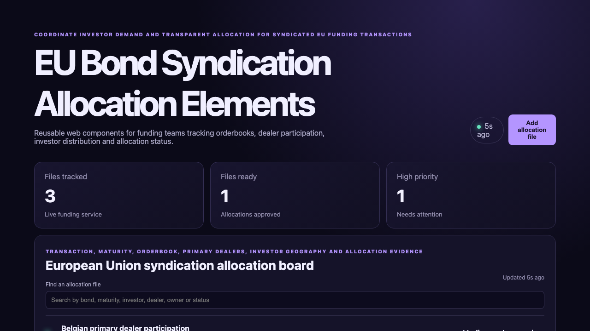

# EU Bond Syndication Allocation Elements

## One-sentence benefit

Give funding teams a shared view of investor demand, dealer participation and EU bond allocations.

## Live demo

[Watch the workflow](docs/demo.webm).

## Screenshots

## Main features

- Search files by bond, maturity, investor, dealer or status.
- Create allocation files through the Java API.
- Advance files through review and approval.
- Display loading, empty, error and success feedback.
- Reuse encapsulated metric and workspace components responsively.

## Technology used

Lit, TypeScript, native custom elements, shadow DOM, Vite, Spring Boot and Java 21.

## Installation instructions

Install Node.js 22 and Java 21. Run `npm install`, start `cd backend && mvn spring-boot:run`, then run `npm run dev`.

## Commercial licensing/contact

Commercial licensing and integration support are available through the repository contact options.

## Business problem and users

Funding, syndication, primary-dealer and investor-relations teams need consistent orderbook and allocation evidence.

## Key workflows

Find an allocation, create a review file, inspect ownership, advance readiness and confirm updated metrics.

## Lit/Web Components framework highlights

Lit properties drive API state, repeat directives render keyed records, shadow DOM encapsulates styles and custom elements reuse metrics.

## Java backend highlights

Spring Boot provides validated list, search, create and update endpoints, errors, health status and tests.

## Architecture and state flow

The custom element calls `/api/items`; Spring Boot validates data and returns updated allocation files.

## Accessibility and responsive behaviour

Labelled controls, semantic regions, visible states, keyboard buttons and responsive components support varied layouts.

## Verification commands

Run `npm test`, `npm run build`, `cd backend && mvn test` and `cd backend && mvn package`.

## Structure

`src` contains custom elements, `backend` contains Java and `docs` contains inspected media.

## Tradeoffs

The sample uses in-memory data; production should add maker-checker roles, durable audit records and market-data controls.

## Roadmap

Add tranches, pricing, investor categories, allocation rules, dealer analytics and downloadable reports.
